<p align="center">
  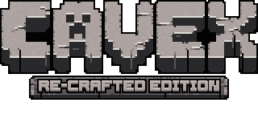
</p>

<p align="center">Survival and building for Wii, with the feel of Beta 1.7.3.</p>

<p align="center">
  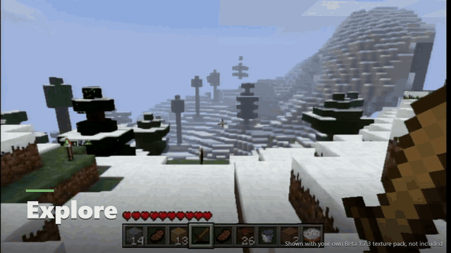
  <br>
  Shown with your own Beta 1.7.3 textures - not included
</p>

<h2 align="center"><a href="https://github.com/Bag-Heads/CavEX-ReCrafted/releases/tag/v0.1.0">Download v0.1.0</a></h2>

<p align="center"><sub>v0.1.0 is marked <b>UNCERTIFIED</b>: one 31.7 ms frame failed the strict release speed gate. Treat it as a test build.</sub></p>

<p align="center">
  <a href="#install-on-wii">Install</a> ·
  <a href="#controls">Controls</a> ·
  <a href="#texture-packs">Texture packs</a> ·
  <a href="#proof-status">Proof status</a>
</p>

## What it is

**CavEX: Re-Crafted Edition**, by **BagHeads**, is a blocky survival and building game for the Nintendo Wii. It plays like Beta 1.7.3, runs fast, and is fully playable with Wii controllers.

Built on CavEX and fCavEX, this Wii-first engine aims for Beta 1.7.3 parity: the same world generation, block rules, recipes, redstone timing and fluids. Wii-specific additions are documented in [CHANGES.md](CHANGES.md).

## Explore, build, play together

Everything below is recorded on a real Wii. See [Texture packs](#texture-packs) for the art included in the zip.

<table>
  <tr>
    <td width="50%" valign="top">
      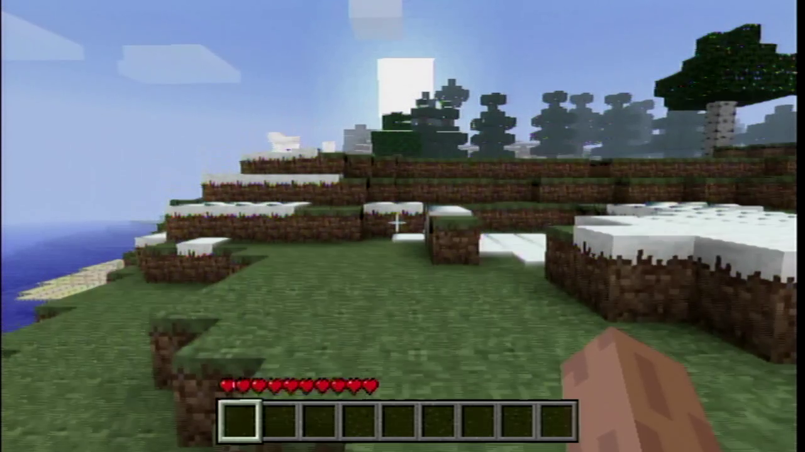
      <h3>Explore Beta worlds</h3>
      <p>Snowy peaks, oceans, caves and ores: Beta world generation, checked by golden tests.</p>
    </td>
    <td width="50%" valign="top">
      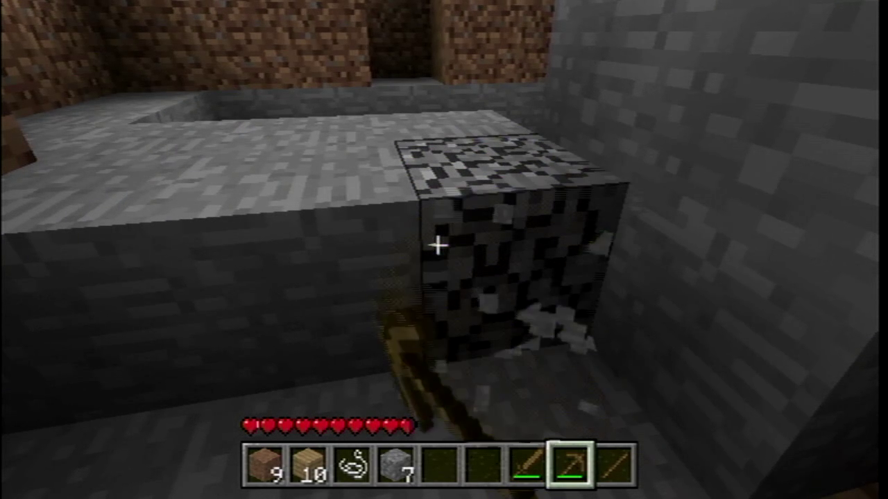
      <h3>Punch trees, mine, craft</h3>
      <p>Beta block rules and recipes, played with the Wii Remote and Nunchuk.</p>
    </td>
  </tr>
  <tr>
    <td width="50%" valign="top">
      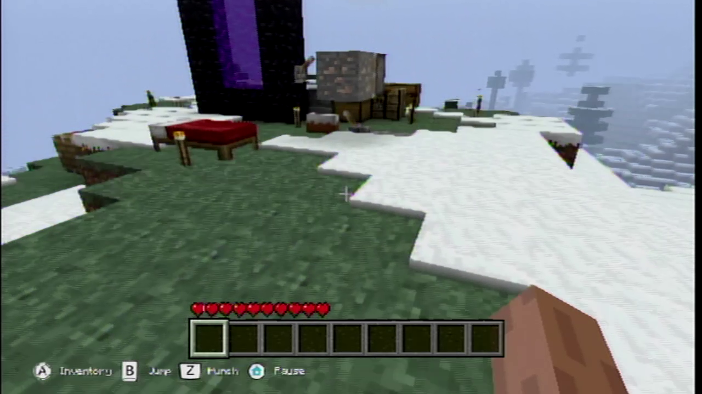
      <h3>Build your base</h3>
      <p>Place, break and build. Saving and reloading are proven on a real Wii.</p>
    </td>
    <td width="50%" valign="top">
      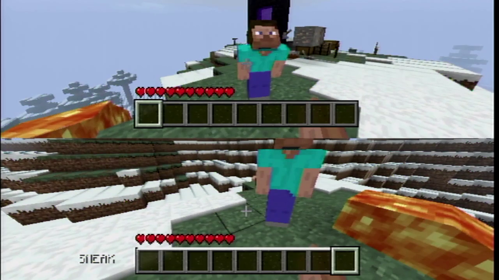
      <h3>Two players, one Wii</h3>
      <p>Local split-screen, each player with their own controller.</p>
    </td>
  </tr>
  <tr>
    <td width="50%" valign="top">
      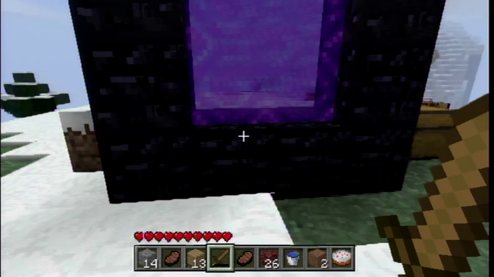
      <h3>Light a portal</h3>
      <p>Obsidian portals work like Beta.</p>
    </td>
    <td width="50%" valign="top">
      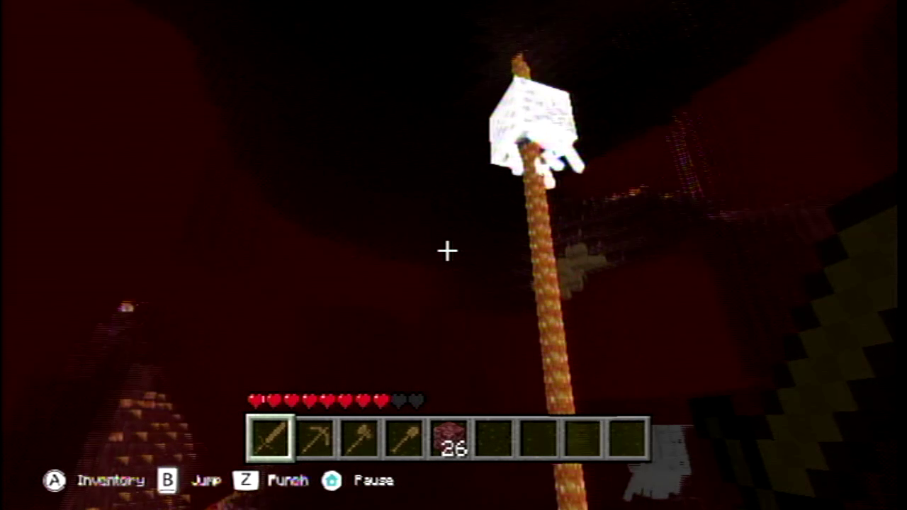
      <h3>Into the Nether</h3>
      <p>Lava seas, fire, pigmen and ghasts in the Beta-style Nether.</p>
    </td>
  </tr>
</table>

<p align="center"><sub>All pictures: real-Wii capture card footage. Shown with your own Beta 1.7.3 textures - not included.</sub></p>

- **Redstone machines:** torches, wire, repeaters and pistons, checked with golden tests and a real-Wii clock run.
- **Optional far land:** distant terrain beyond the normal view distance, through an optional LOD setting.
- **Real Beta servers:** join Beta 1.7.3 servers in offline mode; the pause menu keeps the connection alive.
- **Wii controller UI:** one button-hint row on every screen, notice and disconnect cards, GameCube pad hot-plug.

These features have different levels of proof. The [status table](#proof-status) lists what has been checked and what remains pending.

## New controller UI

<table>
  <tr>
    <td width="50%" valign="top">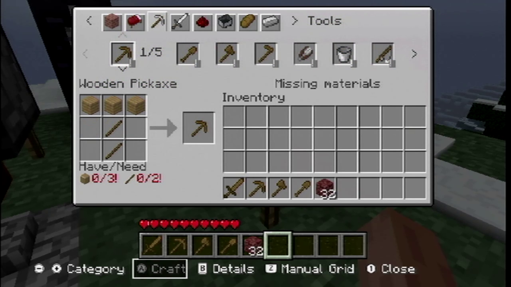<p>Crafting by category, with Have/Need counts.</p></td>
    <td width="50%" valign="top">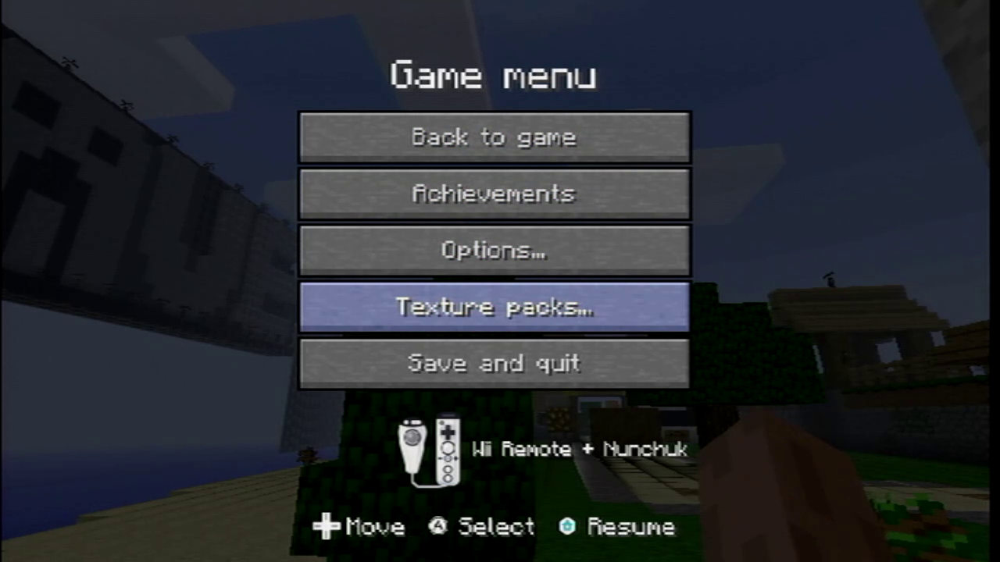<p>Menus show the controller you are holding.</p></td>
  </tr>
  <tr>
    <td width="50%" valign="top">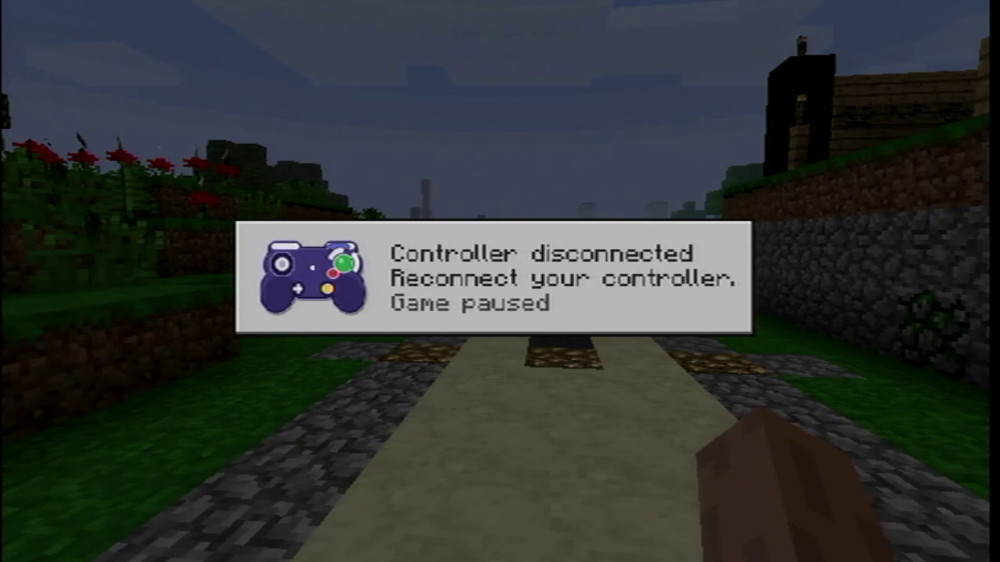<p>Pull a controller and the game pauses until it is back.</p></td>
    <td width="50%" valign="top">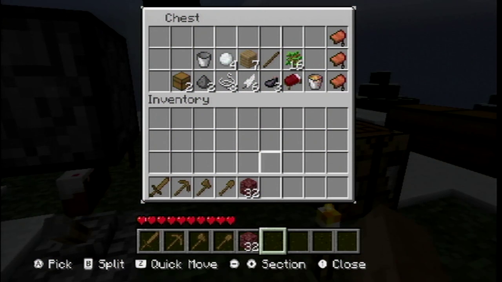<p>One button-hint row on every screen, for Wii Remote, Classic and GameCube.</p></td>
  </tr>
</table>

<p align="center"><sub>Real-Wii capture card footage. Shown with your own Beta 1.7.3 textures - not included.</sub></p>

In game, your coordinates and FPS show on screen. Turn them off with `ui.show_coordinates` and `ui.show_fps` in `config.json` (both default on; hidden while F3 is open).

## Texture packs

### Included in the zip

<table>
  <tr>
    <td width="50%" valign="top">
      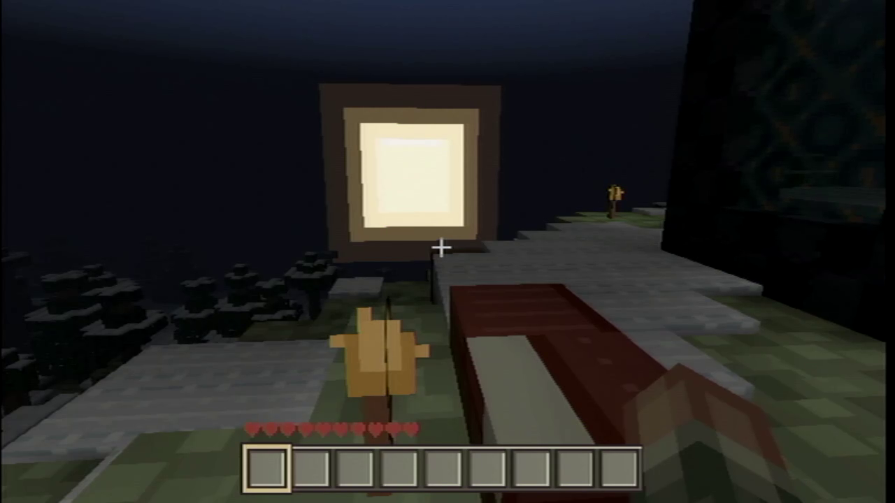
      <h3>Earth &amp; Ash</h3>
      <p>The default pack. Original art, released under CC0 1.0.</p>
    </td>
    <td width="50%" valign="top">
      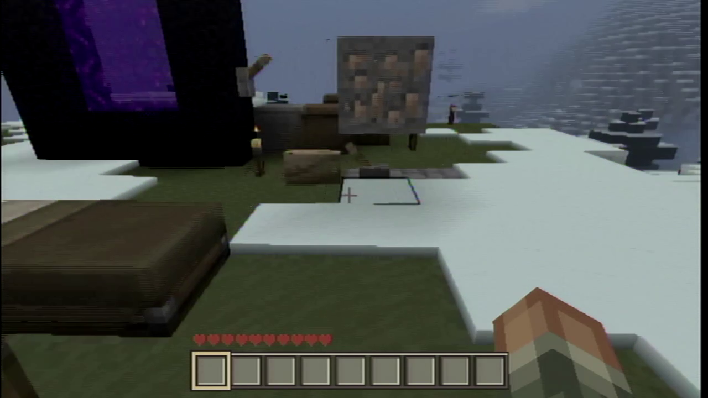
      <h3>Isabella II</h3>
      <p>An optional pack by Bonemouse, available from the pack picker. Some files were modified for this game.</p>
      <p><a href="http://creativecommons.org/licenses/by/3.0/">CC BY 3.0</a> · <a href="http://www.minecraftforum.net/topic/242175-Isabella/">Original pack</a></p>
    </td>
  </tr>
</table>

### Bring your own Beta look and sound

**Beta 1.7.3 textures and sounds are not included.** You need your own `b1.7.3` jar to use them.

**Easiest (Windows): CavEX Asset Importer.** Download `CavEX-Asset-Importer-windows.zip` from the [latest release](https://github.com/Bag-Heads/CavEX-ReCrafted/releases/latest), unzip it, run `CavEX Asset Importer.exe`, and point it at your `b1.7.3.jar` and your SD card (with the game already on it). It finds your Beta sounds in `.minecraft/resources` by itself and builds a **Beta 1.7.3** pack on the card. Nothing is downloaded.

On the Wii itself (not yet confirmed on a real Wii; use the PC way if it fails):

1. Copy your own `b1.7.3.jar` to `sd:/beta/b1.7.3.jar`.
2. For sounds, optionally copy the `sound`, `newsound`, `music` and `newmusic` folders from your `.minecraft/resources` to `sd:/beta/resources/`, plus `streaming/13.ogg` and `cat.ogg`.
3. Open **Texture Packs** in the game and choose **Import Beta 1.7.3**. Wait for **Done**, then select the **Beta 1.7.3** pack.


You can also unzip your jar into `sd:/texturepacks/<name>/` by hand. This route has no sounds unless you add them: point the sound folder at `.minecraft/resources`.

See [the install guide, section 6](docs/release-install.md) for details.

## Install on Wii

You need a Wii with the **Homebrew Channel** and a **FAT32 SD card**.

1. [Download a release](https://github.com/Bag-Heads/CavEX-ReCrafted/releases) and unzip it on your PC. Run `sha256sum -c SHA256SUMS`; every line must say **OK**. A zip ending in `-UNCERTIFIED` has no real-Wii proof and should be treated as a test build.
2. Copy **everything** in the zip to the **root of the SD card**, keeping the folders: `apps/CavEX/`, `assets/`, `saves/`, `texturepacks/` and the rest. Settings and art are on the card twice on purpose.
3. Start the Homebrew Channel and choose **CavEX: Re-Crafted Edition**.
4. Try the **Tutorial** button on the title screen for a guided trail. (The tutorial world is not in the Play game > Load list.)

If `config.json` is lost or broken, the game falls back to `config_wii.json`.

Full instructions: [release install guide](docs/release-install.md).

## Controls

Play with a **Wii Remote + Nunchuk**, **Classic Controller** or **GameCube controller**.

| Action | Wii Remote + Nunchuk | Classic Controller | GameCube |
|---|---|---|---|
| Walk | D-pad | Left stick | Control stick |
| Look | Nunchuk stick | Right stick | C-stick |
| Jump | B | A | A |
| Break / attack | Nunchuk Z | ZR | R |
| Place / use | Nunchuk C | ZL | L |
| Inventory | A | X | Y |
| Sneak (tap on, tap off) | Button 1 | Y | Z |
| Hotbar previous / next | Minus / Plus | Full L / full R | B / X |
| Chat (online) | Tap Button 2 | D-pad Up | D-pad Up |
| Pause | Home | Home | Start |

Drop items from the inventory screen; no controller has a throw button. If a controller disconnects, the game pauses until it returns and you press a button. In two-player split-screen, a new controller takes over a player whose controller is gone.

The source of truth is [the controls sheet](docs/controls_sheet.md), section 1, Revision 2. Physical acceptance by the maintainer is still pending. Sections 2 and 3 cover menus and the chat keyboard.

## Real Beta servers

Join **Beta 1.7.3 servers (protocol 14)** in **offline mode**, with `online-mode=false` on the server. Online-mode authentication is not supported.

Testing uses a pinned vanilla Beta 1.7.3 server. Its jar hash is still to be filled in by the maintainer after R14. Real-Wii sessions have run for 10 minutes, including keeping the connection through the pause menu; see the status below for the newest-build caveat.

## Proof status

**As of 2026-10-30.** A **candidate** passed on a real Wii on a pre-final build and will be re-run on the release build. Candidate results do not establish final-build proof.

| Area | Evidence | Status / remaining check |
|---|---|---|
| Redstone: torches, wire, repeaters, pistons | Redstone golden tests and a 2-minute real-Wii clock run | Candidate |
| Optional far land | Distant terrain beyond normal view distance | Candidate; far-walk rerun pending |
| Two-player split-screen | Two players on one Wii; far land off during split | Candidate |
| Beta server connection | 10-minute real-Wii sessions; connection survives the pause menu | Candidate; newest-build result was still running when the source facts were drafted |
| World generation, caves, ores, trees, Nether | Golden tests | Candidate; spawn-position sweep pending |
| Save and reload | Real-Wii `save_reload_3m` | Proven on real Wii |

## Known issues

Read [KNOWN_ISSUES.md](KNOWN_ISSUES.md) for the known-issues list.

## Building from source

### Wii

Use **devkitPro devkitPPC** with the **patched libogc sidecar** and its **256 KB KERNEL_HEAP**. Stock libogc starves the Wiimote. The recipe is in [third_party/libogc-kernel-heap/README.md](third_party/libogc-kernel-heap/README.md).

Use the `cwbuild wii-release` flow. Release builds are gated on a changed md5, build ID, TLS and the boot-safety check.

### PC tests

```sh
cmake --preset verify && cmake --build --preset verify
ctest --test-dir build-verify
```

## Credits

By **BagHeads**, building on the work of:

| Contribution | Credit |
|---|---|
| CavEX engine | xtreme8000 — GPLv3 |
| fCavEX | yyy257, ByteBit and jilleb |
| Boot credit cards | © 2026 BagHeads — CC BY-ND 4.0 |
| Wii hand pointer | Homebrew Channel team, Team Twiizers / fail0verflow — GPLv2, used unchanged |
| Controller button glyphs | WiiBrew uploaders Clorox, Hiker13526, Flark and Crayon — used with credit; no licence stated on WiiBrew |
| Isabella II textures | Bonemouse — CC BY 3.0 |

Libraries include cglm (MIT), cNBT (Beer-ware), lodepng (zlib-style), parson (MIT), m-lib (BSD-2), miniaudio and stb_vorbis (public domain option), libogc (zlib/BSD-2, patched sidecar), and zlib.

Full credits: [NOTICE](NOTICE). Licence texts: [LICENSES/](https://github.com/Bag-Heads/CavEX-ReCrafted/tree/HEAD/LICENSES).

## History

This project branched from [jilleb/fCavEX](https://github.com/jilleb/fCavEX) at commit [`7023e0e`](https://github.com/jilleb/fCavEX/commit/7023e0e025ac5ad45e389755192e84392ee1b040) (2025-08-31), itself a fork of [xtreme8000/CavEX](https://github.com/xtreme8000/CavEX). See those repositories for the upstream commit history and authors. About 3,550 commits of CavEX: Re-Crafted Edition work followed; this public repository starts from a single clean snapshot of that work (release 0.1.0).

## Licence

**GPLv3** — see [LICENSE](LICENSE). Third-party parts use their own licences, listed in [NOTICE](NOTICE).

Not affiliated with, endorsed by or sponsored by **Mojang or Nintendo**. No Mojang or Nintendo files are included. You need your own Beta 1.7.3 jar for the Beta look and sound.
